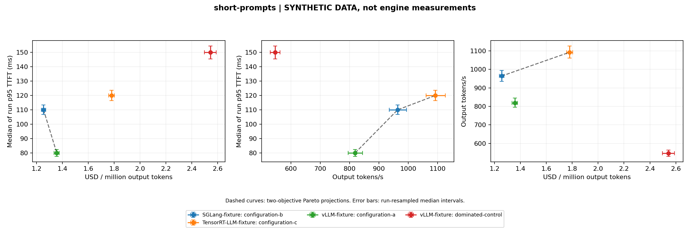

# Comparing serving engines without misleading yourself

This is a published methodology deep dive. No vLLM, SGLang or TensorRT-LLM GPU experiment has been run for this report. The figure uses invented fixture data solely to validate the reporting code.



## What must stay comparable

An engine name is not a benchmark configuration. Record immutable model/tokenizer revisions, hardware count and architecture, engine version, context shape, concurrency, arrival process, warmup, failures and output length policy. Separate short prompts, heavy prefill and heavy decode. A blended average can hide a configuration that helps one workload and hurts another.

The reporter groups matching hardware/model/tokenizer/workload/source records. It keeps failures visible and excludes incomplete candidates from frontier selection. Report every retry; picking the fastest successful run after failures is biased. Archive launch arguments and raw per-request trace hashes beside the table.

## What a latency point means

The chart uses the median of each run's p95 TTFT, not the p95 of pooled requests. Raw traces are needed for pooled percentiles and tail inspection. Keep client queue time and server TTFT definitions consistent. Compare service-level goodput as well as saturation throughput; a saturated engine may still violate real arrival-time objectives.

Run-level bootstrap intervals expose repeat sensitivity. Three repeats are a minimum software check, not strong statistical evidence. Hardware conclusions need thermal steady state, randomized configuration order and independent restarts. Record incomplete requests and memory failures, not just HTTP success.

## Use the public tool

```powershell
python benchmark_report.py projects/15-public-benchmarks/benchmark-fixture.csv --out results/benchmark-report
```

Add `--plot` after installing `requirements-report.txt` in an isolated environment. Replace fixtures with measured rows before asserting engine advantages. Inspect the [generated report](reports/report.md) and [raw fixture CSV](benchmark-fixture.csv).
