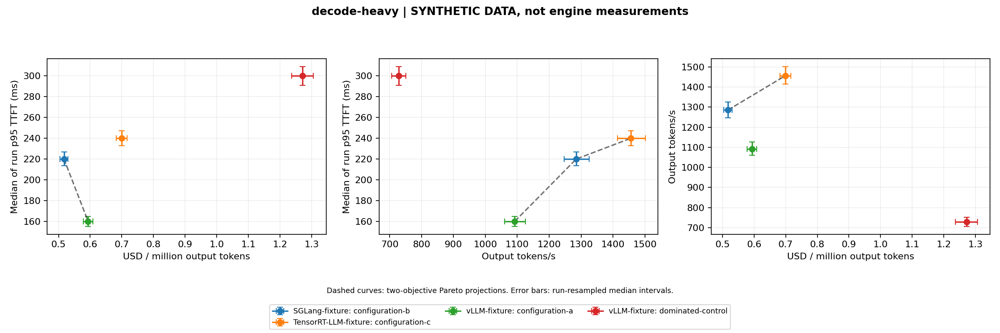

# A benchmark teardown should be reproducible and falsifiable

This methodology deep dive uses synthetic data. The repository currently makes no real hardware performance ranking.

## Publish the evidence chain

Keep launch arguments, driver/runtime versions, hardware topology, model/tokenizer identifiers, corpus hashes, sampling settings and raw results. Every record needs a source label. The reporter hashes its CSV; that identifies analyzed input but does not authenticate measurements or prices. A caller-supplied hardware label is not independently verified hardware.

Preserve OOMs, readiness failures, incomplete generation and timeouts. Batch size and prefix-cache policy affect memory and tails. Dropping failed runs changes the question being answered.

## Quality needs separate measurement

Quantization comparisons need held-out scoring with identical token IDs, masks and context policy. Speculative sampling needs target-distribution validation under compatible sampling transforms/tokenizers. Semantic caching needs incorrect-reuse evaluation on held-out queries, not similarity alone. The public cache fixture includes a wrong answer reuse above 98% similarity.

CPU fixture success, parsing GPU source and importing a Grafana dashboard prove different software properties. They do not prove CUDA correctness, real KV transfer, model quality, throttling or inference speed. Preserve those distinctions when later adding hardware evidence.

## Before a measured teardown

Collect repeated real runs for all three engines on the same identified GPU, verify launch/data provenance, evaluate quality and publish raw traces plus measured curves. That hardware work is outside the non-GPU goal. The current deliverable is reporting software, correctness tests, three methodology articles and explicitly synthetic charts.
