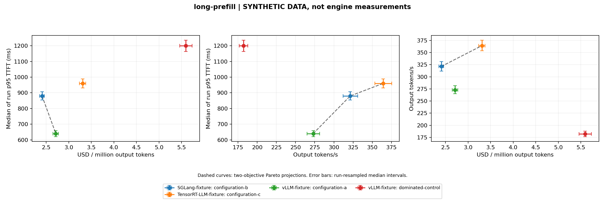

# Inference comparison report

This is derived analysis of supplied records. Prices and hardware provenance are not independently verified.

## Context 1: decode-heavy

**SYNTHETIC FIXTURE DATA: no engine measurements or real prices.**

```json
{
  "hardware": "SYNTHETIC-HARDWARE, no GPU used",
  "model_revision": "fixture-model-v1",
  "tokenizer_revision": "fixture-tokenizer-v1",
  "workload": "decode-heavy",
  "input_tokens": 256,
  "output_tokens": 1024,
  "request_count": 64,
  "source_kind": "fixture",
  "concurrency": 64,
  "request_rate": "inf",
  "arrival_process": "closed-loop",
  "sampling_policy": "fixed-output-greedy-fixture",
  "warmup_requests": 8,
  "seed": 42
}
```

| Candidate | Complete runs | Output tokens/s | Median run p95 TTFT (ms) | USD / million output tokens | Eligible | 3-objective Pareto |
| --- | --- | --- | --- | --- | --- | --- |
| SGLang-fixture: configuration-b | 3/3 | 1285.020 | 220.000 | 0.517 | True | True |
| TensorRT-LLM-fixture: configuration-c | 3/3 | 1456.356 | 240.000 | 0.699 | True | True |
| vLLM-fixture: configuration-a | 3/3 | 1092.267 | 160.000 | 0.593 | True | True |
| vLLM-fixture: dominated-control | 3/3 | 728.178 | 300.000 | 1.272 | True | False |

Eligible candidates require every recorded run to complete and at least the requested repeat count. Failed/incomplete candidates remain visible but are excluded from Pareto selection.

## Context 2: long-prefill

**SYNTHETIC FIXTURE DATA: no engine measurements or real prices.**

```json
{
  "hardware": "SYNTHETIC-HARDWARE, no GPU used",
  "model_revision": "fixture-model-v1",
  "tokenizer_revision": "fixture-tokenizer-v1",
  "workload": "long-prefill",
  "input_tokens": 3072,
  "output_tokens": 128,
  "request_count": 64,
  "source_kind": "fixture",
  "concurrency": 64,
  "request_rate": "inf",
  "arrival_process": "closed-loop",
  "sampling_policy": "fixed-output-greedy-fixture",
  "warmup_requests": 8,
  "seed": 42
}
```

| Candidate | Complete runs | Output tokens/s | Median run p95 TTFT (ms) | USD / million output tokens | Eligible | 3-objective Pareto |
| --- | --- | --- | --- | --- | --- | --- |
| SGLang-fixture: configuration-b | 3/3 | 321.255 | 880.000 | 2.407 | True | True |
| TensorRT-LLM-fixture: configuration-c | 3/3 | 364.089 | 960.000 | 3.306 | True | True |
| vLLM-fixture: configuration-a | 3/3 | 273.067 | 640.000 | 2.713 | True | True |
| vLLM-fixture: dominated-control | 3/3 | 182.044 | 1200.000 | 5.595 | True | False |

Eligible candidates require every recorded run to complete and at least the requested repeat count. Failed/incomplete candidates remain visible but are excluded from Pareto selection.

## Context 3: short-prompts

**SYNTHETIC FIXTURE DATA: no engine measurements or real prices.**

```json
{
  "hardware": "SYNTHETIC-HARDWARE, no GPU used",
  "model_revision": "fixture-model-v1",
  "tokenizer_revision": "fixture-tokenizer-v1",
  "workload": "short-prompts",
  "input_tokens": 256,
  "output_tokens": 128,
  "request_count": 64,
  "source_kind": "fixture",
  "concurrency": 64,
  "request_rate": "inf",
  "arrival_process": "closed-loop",
  "sampling_policy": "fixed-output-greedy-fixture",
  "warmup_requests": 8,
  "seed": 42
}
```

| Candidate | Complete runs | Output tokens/s | Median run p95 TTFT (ms) | USD / million output tokens | Eligible | 3-objective Pareto |
| --- | --- | --- | --- | --- | --- | --- |
| SGLang-fixture: configuration-b | 3/3 | 963.765 | 110.000 | 1.255 | True | True |
| TensorRT-LLM-fixture: configuration-c | 3/3 | 1092.267 | 120.000 | 1.780 | True | True |
| vLLM-fixture: configuration-a | 3/3 | 819.200 | 80.000 | 1.356 | True | True |
| vLLM-fixture: dominated-control | 3/3 | 546.133 | 150.000 | 2.543 | True | False |

Eligible candidates require every recorded run to complete and at least the requested repeat count. Failed/incomplete candidates remain visible but are excluded from Pareto selection.

## Interpretation limits

Each latency summary is a median of per-run p95 values, not a pooled-request p95. Bootstrap intervals resample whole runs; three repeats offer weak uncertainty evidence. Raw per-request traces are needed to inspect tails and failures.

Cost uses the supplied total-footprint hourly price and billed seconds, divided by successful observed output tokens. It excludes costs not included in those inputs. Billed time must cover the benchmark window; idle/warmup/startup must be included if billed. Costs are not current price quotations.

Pareto comparisons stay within matching hardware, model/tokenizer revisions, workload shape and source kind. A frontier says that no eligible candidate dominates all three measured axes; it does not establish answer quality, causal improvement, universal superiority or a production recommendation.

## Pareto charts





