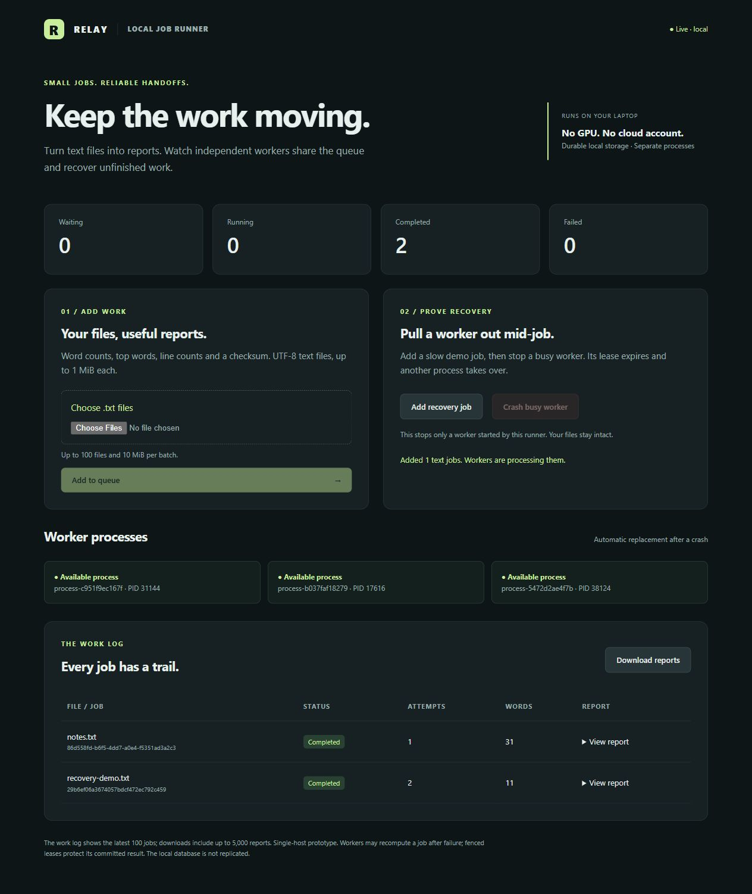

# Reliable text job runner

For applications beyond text reports, read the [domain and GTM engineering guide](../../DOMAIN_APPLICATION_GUIDE.md). Domain workflows are proposals, not implemented features.

Relay turns UTF-8 text files into reports using durable SQLite jobs and separate worker processes. Its live dashboard lets you upload files, inspect reports, download results and kill a managed worker to watch recovery. No third-party Python packages, GPU or cloud account are required.



From the repository root, run `python job_dashboard.py`, or double-click `start-relay.cmd` on Windows with Python 3.11 installed. It starts three worker processes and opens the local dashboard at `http://127.0.0.1:8765`. Stop it with Ctrl+C: workers drain current jobs before exit. Change the port with `--port` and the worker count with `--workers` (1 to 8). Reopening with the same database preserves jobs and completed reports. The database defaults to `results/job-runner/jobs.db`; use `--db` for a separate session.

Choose sample files from [sample-files/](sample-files/), then **Add to queue**. For recovery, choose **Add recovery job**, then **Crash busy worker** while it runs. The worker PID changes, the attempt count increases and the report completes after lease expiry. With concurrent work the crash button selects a busy managed worker; its notice identifies the affected job. It never kills an unrelated process.

The [recorded CLI recovery evidence](../../evidence/job-runner-recovery.json) captures an actual child-process kill, two attempts and the correct final report. Browser verification also covered sample-file upload, the crash controls and JSON report download. The screenshot contains public sample text only.

```powershell
python job_runner.py demo --out results/job-runner/recovery.json
python job_runner.py submit --folder YOUR_TEXT_FOLDER
python job_runner.py worker
python job_runner.py status
```

Jobs produce word/line/character counts, top words and a content checksum. CLI batches accept 1 to 100 UTF-8 `.txt` files, at most 1 MiB per file and 10 MiB per batch. File contents remain in the local SQLite database under ignored `results/`; no model, external service or GPU is used.

Dashboard batches are submitted as individual jobs. If a request fails halfway through a batch, earlier accepted jobs remain. Retrying the unchanged selection within the same page retains job IDs and avoids duplicate enqueue; reloading the page or selecting files again creates new IDs. The work log shows the latest 100 jobs; JSON downloads include up to 5,000 completed reports. Word counting uses Unicode word characters and internal apostrophes, not linguistic tokenization; empty text has zero lines. Filenames are displayed as text rather than interpreted as HTML.

The server binds only to loopback and checks host, origin and a per-session mutation token. This is a local tool, not a public hosted service with user accounts. Uploaded text is stored unencrypted in the local database. Database size can grow as jobs accumulate; use a separate database for a fresh session and retain any needed reports. Dead jobs remain visible after retry exhaustion and require submitting a new job rather than silent repeated retries.

Leases renew while work runs. A crashed worker's job returns to the queue; after three claims without successful completion it becomes dead. Epoch fencing rejects stale completion. This permits repeated computation but commits one result for a job. It does not guarantee exactly-once external side effects. The coordinator and SQLite storage live on one host, so this is worker-process fault tolerance, not replicated multi-machine storage.

Managed workers also watch a five-second supervisor-session heartbeat. If the supervisor disappears they finish bounded current work and stop claiming jobs, preventing abandoned workers from polling forever. The standalone CLI worker runs until stopped. Timing uses the single host's clock; no distributed clock guarantee is implied.

Validation: `python -m unittest test_job_runner test_job_dashboard test_queue_control -v`. Tests cover real process killing, restart persistence, HTTP submission, duplicate identities, report counts, oversized input, local controls and queue fencing. This is correctness evidence, not a distributed throughput benchmark.
